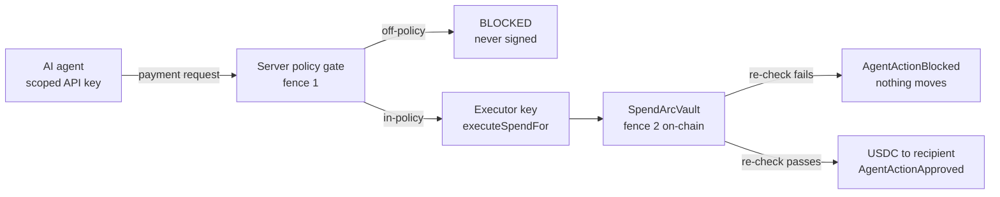

# SpendArc


**Hand an AI agent a wallet that holds nothing and can only ever move value inside policy.**

Autonomous agents need to move money to act, but an unrestricted key plus one prompt injection or runaway loop can drain it.
SpendArc gives each agent a policy-checked USDC vault on Arc: the agent holds no funds, a server policy gate rejects off-policy requests before they are ever signed, and the vault re-checks every spend on-chain before a single micro-unit of USDC moves.

Live frontend: *deploy with the one-command script (see [Deploy](#deploy))* · Contracts on Arc mainnet `5042`.

[One command](#see-it-in-one-command) · [The one rule](#the-one-rule) · [Architecture](#architecture) · [How it uses Arc](#how-it-uses-arc) · [Tests](#tests) · [Deploy](#deploy)

Built for the Circle *Arc Microgrants* program on Arc mainnet, MIT licensed.
SpendArc is developer infrastructure for bounding agent spend; it is not a custodial service and nothing here is financial advice.

## Table of contents

- [See it in one command](#see-it-in-one-command)
- [The one rule](#the-one-rule)
- [What SpendArc does](#what-spendarc-does)
- [Architecture](#architecture)
- [Component by component](#component-by-component)
- [Safety, enforced in code](#safety-enforced-in-code)
- [How it uses Arc](#how-it-uses-arc)
- [Proven on Arc mainnet](#proven-on-arc-mainnet)
- [Engineering decisions](#engineering-decisions)
- [What is real vs pending](#what-is-real-vs-pending)
- [Tests](#tests)
- [Run it locally](#run-it-locally)
- [The one-flow demo](#the-one-flow-demo)
- [Configuration](#configuration)
- [Deploy](#deploy)
- [Project layout](#project-layout)
- [Tech stack, credits, roadmap](#tech-stack-credits-roadmap)
- [Disclaimer and license](#disclaimer-and-license)

## See it in one command

Contracts:

```bash
cd SpendArc
forge build  # compile the vault + factory
forge test   # 24 passing
```

Frontend:

```bash
cd SpendArc/web
npm install
cp .env.example .env.local  # fill in the values from Configuration
npm run dev  # http://localhost:3000
```

After it is running, connect a wallet, create your vault with a leash, deposit USDC, register an agent to mint a one-time API key, and hand that key to any AI agent.
Every write is a real transaction your wallet signs.

## The one rule

**An agent can never move value outside the policy its owner set.**

That rule is enforced in three layers, and no layer trusts the one before it:

1. *Key scope.* The agent holds only a scoped API key, never a private key and never custody of funds. The vault holds the USDC.
2. *Server policy gate (fence 1).* Every payment request is checked against the owner's leash - active, not expired, per-tx cap, daily cap, per-service budgets, recipient and token allowlists - before the executor key signs anything. An off-policy request is answered with a structured `BLOCKED` decision and is never broadcast.
3. *Contract layer (fence 2).* `executeSpendFor` re-checks the full on-chain policy before moving USDC. A blocked action emits `AgentActionBlocked` and moves nothing - no revert, no state change.

## What SpendArc does

### Self-serve vault creation

One signature deploys a vault owned by the caller through `SpendArcVaultFactory` (one vault per wallet), pre-configured with the chosen leash and pre-allowlisted to USDC and the owner's own address.

```text
createVault(maxPerTx, dailyCap, expiry) -> new SpendArcVault owned by msg.sender
```

The factory records the vault and authorizes the platform executor to spend within policy only - it can never change policy or withdraw.

### Policy-checked payments

An agent requests a payment with its API key; the server runs fence 1, then the executor submits `executeSpendFor`, which runs fence 2 on-chain.

```text
POST /api/payments/request { agentId, recipient, amount, token }
Authorization: Bearer <agent-api-key>
-> APPROVED (tx hash) | BLOCKED (reason)
```

The executor decodes the receipt and only records a payment as confirmed when the vault emits `AgentActionApproved`.

### Per-service budgets

Each allowlisted payee carries its own per-tx and daily budget, enforced on-chain and mirrored to the server fence, on top of the agent's global leash.

```text
setAllowedService(agent, target, label, maxPerTx, dailyCap, expiry, allowed)
```

### Owner-signed, chain-first policy changes

The vault owner tightens a leash or allowlists a service by signing the change in their own wallet; the server store is then updated only after the on-chain change is verified, so the two fences never drift apart.

## Architecture

**Decision 1: the vault is the source of truth.** The server policy store is a mirror of on-chain state, never an independent authority, so a bug or bypass in the server cannot loosen what the chain enforces.

**Decision 2: the executor key is powerless beyond spending within policy.** It can submit `executeSpendFor` but can never change policy, add executors, or withdraw, so its blast radius is bounded by each vault's leash even if it leaks.



| Tier | Runs | Can it move funds? | Responsibility |
| --- | --- | --- | --- |
| Agent | anywhere | No | Requests payments with a scoped key |
| Server gate | Next.js API | No (cannot sign) | Rejects off-policy requests before signing |
| Executor | server key | Only within policy | Submits `executeSpendFor` |
| Vault | Arc mainnet | Yes, within policy | Final on-chain enforcement |
| Owner | owner wallet | Yes (deposit/withdraw) | Sets policy, funds the vault |

## Component by component

Contracts:

| File | Responsibility |
| --- | --- |
| `src/SpendArcVault.sol` | Holds USDC and enforces per-agent policy on every spend |
| `src/SpendArcVaultFactory.sol` | Deploys one owner-controlled vault per wallet |
| `src/MockUSD.sol` | Local test USDC |

Backend (Next.js API):

| Route | Responsibility |
| --- | --- |
| `app/api/agents/user` | Register an agent after a wallet-ownership signature; mint the API key |
| `app/api/payments/request` | Run fence 1 then the on-chain spend (API key required) |
| `app/api/allowlist/[agentId]/sync` | Mirror a verified on-chain allowlist change into the server store |
| `app/api/policies/[agentId]/update` | Return owner-signable calldata for a leash change |
| `app/api/transactions/proof` | Latest approved + blocked actions for the live proof |

Frontend libraries:

| Module | Responsibility |
| --- | --- |
| `web/lib/arc.ts` | Network-aware chain config (defaults to Arc mainnet `5042`) |
| `web/lib/executor.ts` | Submit spends and decode the receipt events |
| `web/lib/serverAuth.ts` | API-key and wallet-signature verification |
| `web/lib/proof.ts` | Live read of the on-chain proof receipts |

## Safety, enforced in code

| Claim | How it is enforced |
| --- | --- |
| An agent cannot spend without a valid key | `payments/request` returns `401` without a matching Bearer key |
| You cannot register a wallet you do not control | registration verifies a signature over a canonical challenge |
| The server fence cannot be loosened out of band | the allowlist/policy store is written only by `/sync` after an on-chain read |
| A spend cannot invoke an arbitrary contract | `executeSpend*` reverts on non-empty calldata; only ERC-20 USDC transfers move value |
| A blocked spend is never counted as paid | the executor records a payment only when `AgentActionApproved` is emitted |
| A leaked executor key cannot drain a vault | the executor can only spend within each agent's on-chain leash |

## How it uses Arc

SpendArc is Arc-native: USDC is the gas token and the unit of account, and the vault enforces spend policy directly on-chain.

Reads: vault policy, per-service budgets, remaining daily cap, and the approved/blocked proof receipts, all read live over Arc RPC.

Writes: `createVault`, `deposit`, `setAllowedService`, `setAgentPolicy` (owner-signed), and `executeSpendFor` (executor-signed).

| Contract | Address |
| --- | --- |
| SpendArcVaultFactory | [`0xd79850b02aFDeE63F9fcB0eB385eB6B1526dB7fb`](https://explorer.arc.io/address/0xd79850b02aFDeE63F9fcB0eB385eB6B1526dB7fb) |
| SpendArcVault (reference) | [`0x8D80cEEe03C86de7d90478c5D7599004f375Ef6F`](https://explorer.arc.io/address/0x8D80cEEe03C86de7d90478c5D7599004f375Ef6F) |
| USDC (native ERC-20 interface) | [`0x3600000000000000000000000000000000000000`](https://explorer.arc.io/address/0x3600000000000000000000000000000000000000) |

RPC `https://rpc.mainnet.arc.io` · Explorer `https://explorer.arc.io` · Chain id `5042`.

## Proven on Arc mainnet

A live same-agent, one-variable proof against the reference vault's $1/tx leash - two spends differing only in amount:

| Action | Amount | Result | Tx |
| --- | --- | --- | --- |
| Approved | 0.5 USDC | `AgentActionApproved`, USDC moved | [`0x05796ab9`](https://explorer.arc.io/tx/0x05796ab956817e1ba45a0cd16dfe931b29e15475f862a8256f34aa37a6fa374a) |
| Blocked | 2 USDC | `AgentActionBlocked`, reason `exceeds maxPerTx`, nothing moved | [`0xbb922fda`](https://explorer.arc.io/tx/0xbb922fda93c6f6cc12e8422864576c5104ccb8c8271721ca06a4d7421806f2ce) |
| Executor authorization | - | `setExecutor` | [`0x9c9081d8`](https://explorer.arc.io/tx/0x9c9081d8cbde6a1b2110f9bf0a69d63155826470d553e92520f41ae3219615e4) |

## Engineering decisions

**The vault never performs an arbitrary call.**
An earlier design let a spend carry calldata and do `target.call{value}(data)`, which is a path to invoking any contract as the vault.
The vault now rejects non-empty calldata and only ever transfers ERC-20 USDC, so a spend cannot be turned into an arbitrary action.

**The server trusts the chain, not the other way around.**
The server policy store exists for fast pre-checks and an audit trail, but it is only ever written to match verified on-chain state.
This means a compromised or buggy server can at worst fail closed; it cannot authorize a spend the chain would reject.

**Registration proves wallet ownership.**
Minting an API key for an address requires a signature over a canonical challenge from that address, so no one can register a vault they do not control or front-run a real owner.

## What is real vs pending

| Capability | Status |
| --- | --- |
| Policy enforcement on-chain | Real - verified on Arc mainnet (see proof txs) |
| Two-fence payment pipeline | Real - server gate plus on-chain re-check |
| Per-service budgets | Real - enforced on-chain and mirrored to the server |
| Wallet-ownership registration | Real - signature verified server-side |
| Hosted live deployment | Not yet established - deploy to a host with the production env set |
| Professional security audit | Not yet established - the current review is deadline-scoped |

The hosted URL and a full audit are the honest next steps; the on-chain enforcement itself is live and verifiable now.

## Tests

| Suite | Tests | Covers |
| --- | --- | --- |
| `test/SpendArcVault.t.sol` | 16 | Caps, expiry, allowlists, per-service budgets, dedup, calldata rejection |
| `test/SpendArcVaultFactory.t.sol` | 8 | One vault per owner, leash validation, wiring |

```bash
cd SpendArc
forge test  # 24 passing
```

Frontend type safety and build:

```bash
cd SpendArc/web
npm run typecheck
npm run build
```

## Run it locally

1. Contracts:

```bash
cd SpendArc
forge build
forge test
```

2. Frontend:

```bash
cd SpendArc/web
npm install
cp .env.example .env.local  # fill in the values from Configuration
npm run dev  # http://localhost:3000
```

3. Point `.env.local` at mainnet or testnet with the matching chain id, RPC, explorer, and deployed addresses.

## The one-flow demo

1. Connect your wallet on the dashboard.
2. Create your vault with a leash (for example $1 per tx, $5 per day).
3. Deposit USDC into the vault.
4. Register your agent - one wallet signature proves ownership and mints a one-time API key.
5. Make an approved payment under the cap and watch it confirm on-chain (`AgentActionApproved`).
6. Make a payment over the cap and watch it get blocked (`AgentActionBlocked`, nothing moves).

## Configuration

Frontend (`web/.env.local`):

| Variable | Purpose |
| --- | --- |
| `NEXT_PUBLIC_ARC_CHAIN_ID` | `5042` for mainnet, `5042002` for testnet |
| `NEXT_PUBLIC_ARC_RPC_URL` | Arc RPC endpoint |
| `NEXT_PUBLIC_ARC_EXPLORER_URL` | Arc explorer base URL |
| `NEXT_PUBLIC_USDC_ADDRESS` | Native USDC ERC-20 interface |
| `NEXT_PUBLIC_FACTORY_ADDRESS` | Deployed factory |
| `NEXT_PUBLIC_VAULT_ADDRESS` | Reference vault |
| `NEXT_PUBLIC_PRIVY_APP_ID` | Privy auth app id |

Server (`web/.env.local`):

| Variable | Purpose |
| --- | --- |
| `EXECUTOR_PRIVATE_KEY` | Signs `executeSpendFor` only; keep separate from the owner key |
| `TURSO_DATABASE_URL` | Policy store (required in production) |
| `TURSO_AUTH_TOKEN` | Policy store auth |

Deploy script (repo root `.env` or inline):

| Variable | Purpose |
| --- | --- |
| `PRIVATE_KEY` | Funded Arc key used by `deploy-mainnet.sh` |
| `EXECUTOR_ADDRESS` | Separate server signer authorized on the factory (recommended) |

## Deploy

Contracts to Arc mainnet, one command - the only input is a funded Arc key:

```bash
cd SpendArc
PRIVATE_KEY=0x<funded-key> ./deploy-mainnet.sh
```

It deploys the factory, creates your reference vault, and prints the `NEXT_PUBLIC_FACTORY_ADDRESS` and `NEXT_PUBLIC_VAULT_ADDRESS` lines to paste into `web/.env.local`.
See [MAINNET.md](./MAINNET.md) for the full checklist, including setting a separate executor key.

Frontend to a host (for example Vercel): set the frontend and server variables from [Configuration](#configuration), including `TURSO_*`, and build with `npm run build`.

## Project layout

```text
SpendArc/
  src/               # Solidity - vault, factory, mock USDC
  test/              # Foundry suite (24 tests)
  script/            # deploy scripts (DeployMainnet is the one-command entry)
  deploy-mainnet.sh  # one-command Arc deploy wrapper
  web/               # Next.js app (marketing + dashboard + API)
  lib/               # vendored deps (OpenZeppelin, forge-std)
  MAINNET.md         # mainnet deploy + go-live checklist
```

## Tech stack, credits, roadmap

### Stack

Solidity `0.8.28`, Foundry, Next.js 15, React 19, viem, wagmi, Privy, Turso/libSQL, Tailwind.

### Credits

Built on Circle's Arc and native USDC, OpenZeppelin contracts, and the Foundry toolchain.

### Roadmap

Hosted deployment, a separate production executor key on the factory, a professional audit before raising caps, and an in-app testnet/mainnet switch for first-time testing.

## Disclaimer and license

SpendArc is developer infrastructure for bounding autonomous-agent spend.
It is not a custodial service, not a wallet, and nothing in this repository is financial advice.
The contracts have had a deadline-scoped security review, not a full audit; do not hold significant value in a vault until an audit is complete.

**MIT licensed.** See [LICENSE](./LICENSE).
